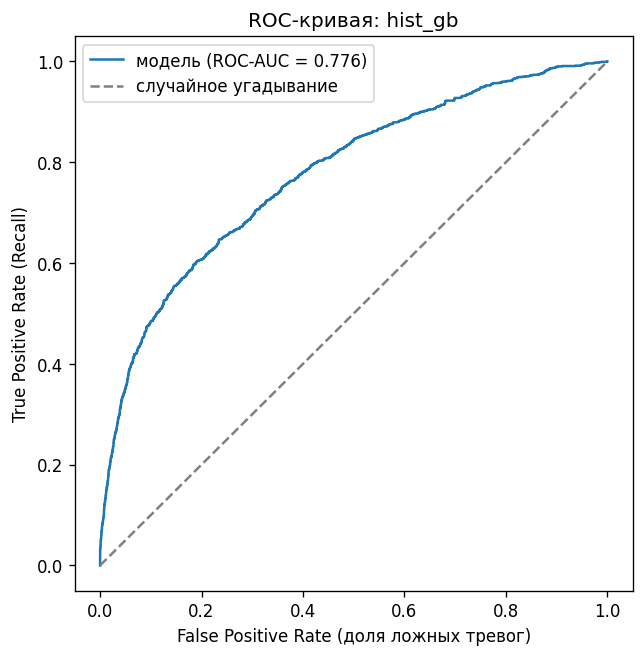
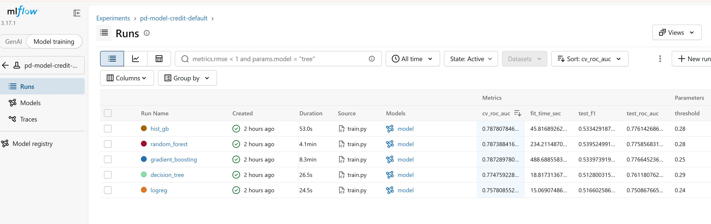
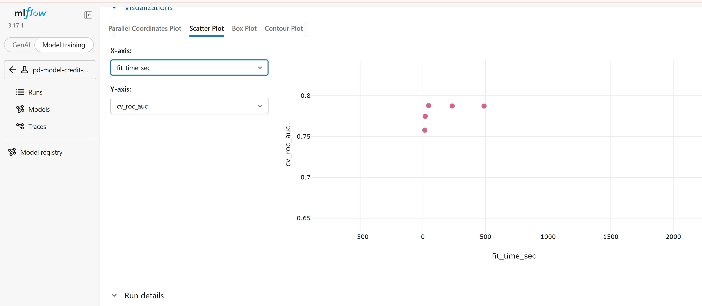
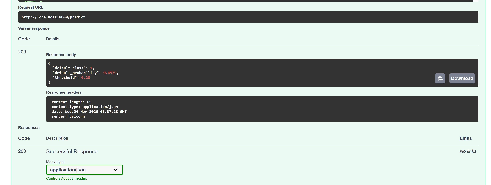

# PD-модель: вероятность дефолта по кредитной карте

Модель оценивает вероятность дефолта (Probability of Default, PD) клиента кредитной карты в следующем месяце.
Данные: [Default of Credit Card Clients](https://archive.ics.uci.edu/dataset/350/default+of+credit+card+clients) (UCI),
30 000 клиентов банка за апрель–сентябрь 2005 года, доля дефолтов 22%.

Проект покрывает весь путь модели: анализ данных, проверку качества данных, обучение с учётом экспериментов,
воспроизводимый конвейер, тесты, CI, REST API в Docker и мониторинг дрейфа.

## Результат

Лучшая модель: HistGradientBoosting внутри sklearn Pipeline.

| Метрика | Значение |
|---|---|
| ROC-AUC, кросс-валидация (5 фолдов) | 0.788 ± 0.007 |
| ROC-AUC, test | 0.776 |
| Gini, test | 0.552 |
| Precision / Recall / F1, test | 0.510 / 0.560 / 0.533 |
| Порог классификации | 0.28 (подобран по F1) |



## Структура проекта

```
data/raw/                       исходный xls (под контролем DVC)
data/processed/                 train.csv, test.csv (создаются шагом prepare)
data/expectations/              правила Great Expectations
models/model.pkl                итоговая модель
notebooks/01_eda.ipynb          разведочный анализ
notebooks/02_experiments.ipynb  анализ экспериментов MLflow
reports/                        метрики, сравнение моделей, отчёт PSI, графики
src/data/                       загрузка, очистка, разбиение, валидация
src/features/                   новые признаки
src/models/                     Pipeline, метрики, обучение с MLflow
src/api/                        REST API на FastAPI
src/monitoring/                 мониторинг дрейфа (PSI)
tests/                          тесты pytest
scripts/                        сборка и запуск Docker
dvc.yaml                        конвейер prepare -> validate -> train -> monitor
Dockerfile                      образ сервиса
.github/workflows/ci.yml        проверки на GitHub Actions
```

## Данные и признаки

Очистка (`src/data/make_dataset.py`): 
- удалены столбец ID и 35 полных дубликатов
- данные разбиты на train и test (80/20) с сохранением доли дефолтов.

Новые признаки (`src/features/build_features.py`), обоснование в `notebooks/01_eda.ipynb`:

| Признак | Смысл |
|---|---|
| `N_DELAYS` | число месяцев с просрочкой из 6 |
| `N_ZERO_PAY` | число месяцев без платежа |
| `PAY_AMT_MEAN` | средний платёж |
| `UTIL`, `UTIL_MEAN` | загрузка лимита (долг / лимит): последний месяц и в среднем |
| `AGE_BIN` | возрастная группа: риск зависит от возраста нелинейно |

Недокументированные коды `EDUCATION` (0, 5, 6) и `MARRIAGE` (0) объединены в категорию «другое».

Признаки считаются внутри модели: трансформер `FeatureEngineer` стоит первым шагом Pipeline,
поэтому API передаёт модели исходные данные клиента.

## Валидация данных

`src/data/validation.py` проверяет данные набором правил Great Expectations (74 проверки): состав столбцов,
пропуски, типы, допустимые диапазоны и коды категорий. Если хотя бы одна проверка не пройдена,
скрипт завершается с кодом 1, и конвейер останавливается.

Тесты в `tests/test_validation.py` специально портят данные (пропуск, возраст 150, пол 3, отрицательный платёж,
пропавший столбец) и проверяют, что валидация это замечает.

## Модель и эксперименты

Pipeline: `FeatureEngineer` -> предобработка (числовые признаки: медиана вместо пропусков и StandardScaler;
категориальные: мода и OneHotEncoder) -> модель.

Сравнивались 5 моделей с подбором гиперпараметров через GridSearchCV (5 фолдов, метрика ROC-AUC).
Все запуски записаны в MLflow: параметры, метрики, ROC-кривая и сама модель.

| Модель | CV ROC-AUC | Test ROC-AUC | Gini | F1 | Время обучения |
|---|---|---|---|---|---|
| HistGradientBoosting | 0.788 | 0.776 | 0.552 | 0.533 | 47 с |
| Случайный лес | 0.787 | 0.776 | 0.552 | 0.540 | 243 с |
| Градиентный бустинг | 0.787 | 0.777 | 0.553 | 0.534 | 464 с |
| Дерево решений | 0.775 | 0.761 | 0.522 | 0.513 | 19 с |
| Логистическая регрессия | 0.758 | 0.751 | 0.502 | 0.517 | 16 с |

Три ансамбля дают почти одинаковое качество: разница между ними меньше разброса между фолдами.
Выбрана HistGradientBoosting: лучший результат на кросс-валидации и обучение в 5–10 раз быстрее.
Модель и порог выбирались только по train, test использован один раз для итоговой оценки.
Подробный анализ в `notebooks/02_experiments.ipynb`.





## Воспроизводимость (DVC)

Конвейер описан в `dvc.yaml`: prepare -> validate -> train -> monitor.
DVC запускает только те шаги, у которых изменился код или данные.

```
pip install -r requirements.txt
dvc repro
dvc metrics show
```

Исходный файл данных хранится в DVC-хранилище автора и в git не входит. Чтобы запустить конвейер с нуля,
скачайте `default of credit card clients.xls` со страницы датасета UCI и положите его в `data/raw/`.

После переобучения с нуля метрики совпали с прежними до четвёртого знака.

## Тесты и CI

32 теста pytest: очистка данных, признаки, валидация, Pipeline и метрики, API, мониторинг.

```
python -m pytest -v
```

При каждом push GitHub Actions (`.github/workflows/ci.yml`) проверяет стиль кода (flake8, black),
запускает валидацию данных на образце `tests/data/sample.csv` и все тесты.

## REST API в Docker

Сервис на FastAPI: `POST /predict` принимает данные клиента и возвращает класс и вероятность дефолта.
Входные данные проверяются: недопустимые значения (например, SEX=3) и пропущенные поля отклоняются с кодом 422.

Нужен установленный и запущенный Docker.

Linux / Mac:
```
git clone https://github.com/QuanntumQueen/pd-model.git
cd pd-model
bash scripts/docker_run.sh
```

Windows (PowerShell):
```
git clone https://github.com/QuanntumQueen/pd-model.git
cd pd-model
powershell -ExecutionPolicy Bypass -File scripts\docker_run.ps1
```

Документация и форма для запросов: http://localhost:8000/docs (POST /predict -> Try it out -> Execute).
Остановить сервис: `docker stop pd-model`.

Без Docker сервис запускается из корня проекта командой `uvicorn src.api.app:app --port 8000`.

Пример ответа для клиента с просрочкой 2 месяца подряд:
```
{"default_class": 1, "default_probability": 0.6579, "threshold": 0.28}
```

| Клиент | Вероятность дефолта | Класс |
|---|---|---|
| Большой лимит, каждый месяц платит всю сумму | 0.08 | 0 |
| Без просрочек, лимит почти исчерпан | 0.21 | 0 |
| Просрочка 2 месяца подряд | 0.66 | 1 |



Возможные проблемы:
- `Cannot connect to the Docker daemon`: Docker не запущен;
- `port is already allocated`: порт 8000 занят, запустите `docker run -d --name pd-model -p 8001:8000 pd-model`
  и откройте http://localhost:8001/docs;
- на Windows «выполнение сценариев отключено»: запускайте скрипт через `powershell -ExecutionPolicy Bypass -File`, как выше.

## Мониторинг дрейфа (PSI)

`src/monitoring/psi.py` считает Population Stability Index для 8 признаков и для прогноза модели.
Эталон — train, с ним сравниваются test и test с искусственным дрейфом (лимиты снижены на 30%,
у всех клиентов просрочка на месяц больше). Пороги: меньше 0.1 — стабильно, 0.1–0.25 — умеренный сдвиг,
больше 0.25 — значительный сдвиг.

```
python -m src.monitoring.psi
```

| Признак | train -> test | train -> дрейф |
|---|---|---|
| LIMIT_BAL | 0.0015 | 0.5473 |
| PAY_0 | 0.0008 | 1.5484 |
| N_DELAYS | 0.0006 | 0.8556 |
| UTIL | 0.0011 | 0.4220 |
| AGE | 0.0009 | 0.0009 |
| BILL_AMT1 | 0.0022 | 0.0022 |
| score (PD) | 0.0006 | 0.4323 |

На test дрейфа нет. На искусственном дрейфе PSI отмечает изменённые признаки, признаки, которые из них
считаются (N_DELAYS, UTIL), и прогноз модели. Остальные признаки остаются стабильными.
Полный отчёт в `reports/psi_report.csv`.
